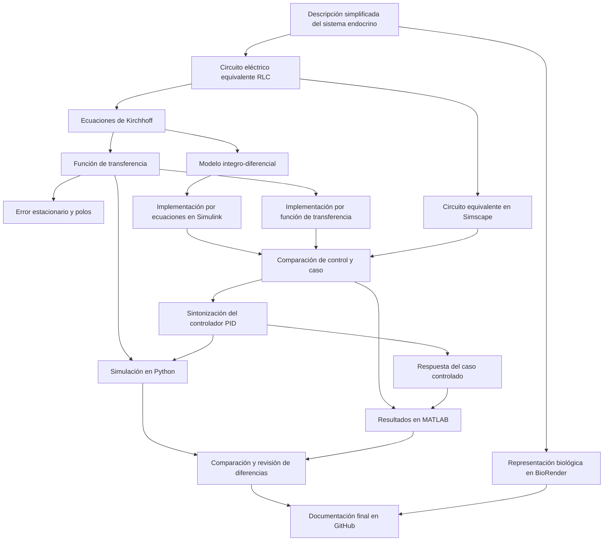

# Práctica 4 — Modelado y control del sistema endócrino

Repositorio académico de la asignatura **Modelado de Sistemas Fisiológicos**, del programa de **Ingeniería Biomédica** del Tecnológico Nacional de México / Instituto Tecnológico de Tijuana. Corresponde a la **sección 5.6** del instructivo de la asignatura.

En esta práctica se representa un proceso de regulación hormonal mediante un **circuito eléctrico RLC de segundo orden**. Se estudian la **función de transferencia**, el **error en estado estacionario** y los **polos** de dos condiciones: una de referencia (**control**) y una modificada (**caso**). Se implementan el circuito equivalente, las ecuaciones integro-diferenciales y las funciones de transferencia en MATLAB/Simulink y Simscape Electrical. Finalmente, se incorpora un **controlador PID** y se comparan las respuestas con una reproducción en Python.

**Estudiante:** Cid Pacheco Emmanuel  
**Número de control:** 23212187  
**Correo institucional:** l23212187@tectijuana.edu.mx  
**Docente:** Dr. Paul Antonio Valle Trujillo  
**Correo del docente:** paul.valle@tectijuana.edu.mx  
**Asignatura:** Modelado de Sistemas Fisiológicos  
**Programa:** Ingeniería Biomédica  
**Departamento:** Ingeniería Eléctrica y Electrónica  
**Institución:** Tecnológico Nacional de México / Instituto Tecnológico de Tijuana

---

<a id="contenido"></a>
## Contenido

1. [Resumen](#resumen)
2. [Competencia y objetivos](#objetivos)
3. [Relación con el temario](#temario)
4. [Modelo endócrino y analogía eléctrica](#modelo)
5. [Valores de los parámetros](#parametros)
6. [Análisis matemático y función de transferencia](#matematicas)
7. [Cálculo del error en estado estacionario](#error)
8. [Evaluación de la estabilidad en lazo abierto](#estabilidad)
9. [Modelo en Simulink y Simscape](#simulink)
10. [Ejecución mediante MATLAB](#matlab)
11. [Diseño y ajuste del controlador PID](#pid)
12. [Interpretación de las gráficas de MATLAB](#resultados)
13. [Desarrollo complementario en Python](#python)
14. [Representación biológica en BioRender](#biorender)
15. [Discusión final](#conclusiones)
16. [Secuencia de trabajo](#flujo)
17. [Materiales y formatos de entrega](#archivos)
18. [Requisitos para reproducir la práctica](#reproduccion)
19. [Fuentes consultadas](#referencias)

---

<a id="resumen"></a>
## 1. Resumen

El sistema endócrino coordina procesos fisiológicos mediante señales hormonales. Para estudiar de manera simplificada su dinámica, la práctica propone una **analogía eléctrica fenomenológica**: una fuente de voltaje representa el estímulo de entrada; dos resistencias, la oposición al transporte y a la utilización o eliminación de la señal; un capacitor, su acumulación temporal; y un inductor, el retardo asociado con la respuesta del tejido diana.

La variable de entrada es $V_e(t)$ y la salida es $V_s(t)$. Se construyen dos escenarios que conservan $R_1=1\,\mathrm{k\Omega}$ y $L=100\,\mathrm{mH}$, pero modifican $C$ y $R_2$. En el **control**, $C=1\,\mu\mathrm{F}$ y $R_2=100\,\mathrm{k\Omega}$; en el **caso**, $C=1000\,\mu\mathrm{F}$ y $R_2=1\,\mathrm{k\Omega}$.

El análisis matemático muestra que ambas plantas son estables en lazo abierto. Frente a un escalón unitario, el control alcanza aproximadamente **0.9901 V**, mientras que el caso alcanza **0.5 V**. La diferencia en las respuestas motiva la incorporación de un controlador PID al escenario modificado. Se comparan las implementaciones mediante ecuaciones, funciones de transferencia, circuito de Simscape, cuaderno de MATLAB y programa de Python.

El material biológico de BioRender presenta el **hipotiroidismo** como contexto ilustrativo. Es importante distinguir esa ilustración de la planta eléctrica: los valores de $R_1$, $R_2$, $C$ y $L$ son parámetros didácticos, **no** mediciones ni parámetros clínicos validados de un eje tiroideo.

**Palabras clave:** sistema endócrino; regulación hormonal; analogía eléctrica; RLC; función de transferencia; controlador PID; MATLAB; Simulink; Simscape Electrical; Python.

[Volver al contenido](#contenido)

---

<a id="objetivos"></a>
## 2. Competencia y objetivos

### Competencia a desarrollar

Modelizar sistemas fisiológicos mediante circuitos eléctricos equivalentes, ecuaciones integro-diferenciales y funciones de transferencia, para analizar sus respuestas dinámicas y aplicar técnicas de control clásico.

### Objetivo general

Modelar y controlar un sistema endócrino simplificado mediante un circuito RLC de segundo orden, comparando una condición de referencia con una condición modificada y evaluando el efecto de un controlador PID.

### Objetivos específicos

- Identificar las variables de entrada, salida y los flujos del modelo hormonal.
- Construir y analizar el circuito equivalente con $R_1$, $C$, $L$ y $R_2$.
- Formular las ecuaciones integro-diferenciales y obtener la función de transferencia $V_s(s)/V_e(s)$.
- Calcular la respuesta final, el error en estado estacionario y los polos de ambos escenarios.
- Implementar funciones de transferencia, ecuaciones y circuitos equivalentes en Simulink/Simscape.
- Comparar las respuestas ante un escalón de entrada y diseñar una retroalimentación con PID.
- Reproducir las curvas mediante MATLAB y Python, señalando el alcance de cada verificación.
- Documentar el análisis, las simulaciones, las evidencias y la representación biológica.

[Volver al contenido](#contenido)

---

<a id="temario"></a>
## 3. Relación con el temario

| Área | Contenidos aplicados |
|---|---|
| Modelado matemático | Analogía eléctrica, leyes de Kirchhoff, ecuaciones integro-diferenciales y funciones de transferencia |
| Sistemas de control | Lazo abierto, respuesta al escalón, error en estado estacionario, polos y estabilidad |
| Controladores | Retroalimentación negativa, PID continuo, sintonización de ganancias y desempeño transitorio |
| Herramientas computacionales | MATLAB, Simulink, Simscape Electrical, Python y representación gráfica |

[Volver al contenido](#contenido)

---

<a id="modelo"></a>
## 4. Modelo endócrino y analogía eléctrica

### Interpretación de los elementos

| Variable o elemento | Representación eléctrica | Interpretación didáctica |
|---|---|---|
| Estímulo hormonal | $V_e(t)$ | Señal que inicia la respuesta del sistema |
| Flujo de entrada | $F_e(t)$ | Corriente asociada con el transporte de la señal |
| $R_1$ | Resistencia en serie | Oposición efectiva al transporte |
| $C$ | Capacitor a tierra | Almacenamiento temporal de la señal |
| $L$ | Inductor | Retardo o inercia de la respuesta del tejido diana |
| $R_2$ | Resistencia de la rama de salida | Disipación, utilización o eliminación de la señal |
| Flujo de salida | $F_s(t)$ | Corriente de la rama del órgano diana |
| Nivel hormonal efectivo | $V_s(t)$ | Voltaje del nodo principal respecto a tierra |

### Construcción del circuito equivalente

La fuente $V_e(t)$ alimenta la resistencia $R_1$. En el nodo posterior a esa resistencia se mide $V_s(t)$ y se conectan **dos ramas en paralelo**: el capacitor $C$ hacia la referencia y una rama formada por $L$ y $R_2$ **en serie** hacia la misma referencia.

```text
                         Fe(t) →
             R1
   Ve(t) ───/\/\/\───●────────────┐
     │              │ Vs(t)       │
     │              │            L
     │              C            │  Fs(t) ↓
     │              │            R2
     │              │            │
     └──────────────┴────────────┘
                    GND
```

El circuito contiene dos elementos independientes de almacenamiento de energía ($C$ y $L$), por lo que su dinámica es de **segundo orden**. El desarrollo manuscrito y el dibujo del circuito se encuentran en [AnalisisMatematico.pdf](AnalisisMatematico.pdf).

[Volver al contenido](#contenido)

---

<a id="parametros"></a>
## 5. Valores de los parámetros

| Componente | Control: referencia | Caso: condición modificada |
|---|---:|---:|
| Entrada $V_e(t)$ | Escalón unitario, 1 V | Escalón unitario, 1 V |
| $R_1$ | 1 kΩ | 1 kΩ |
| $L$ | 100 mH | 100 mH |
| $C$ | 1 µF | 1000 µF |
| $R_2$ | 100 kΩ | 1 kΩ |

La capacitancia del caso es **1000 veces mayor**, mientras que su resistencia $R_2$ es **100 veces menor**. Estas modificaciones alteran tanto la ganancia en estado estacionario como la rapidez de la respuesta. Los parámetros proceden del instructivo y coinciden con los establecidos en las funciones de transferencia y circuitos de los materiales de Simulink.

[Volver al contenido](#contenido)

---

<a id="matematicas"></a>
## 6. Análisis matemático y función de transferencia

El procedimiento completo manuscrito se encuentra en **[AnalisisMatematico.pdf](AnalisisMatematico.pdf)**. A continuación se presenta un resumen de las relaciones fundamentales.

### Leyes de Kirchhoff

La corriente que pasa por $R_1$ es

$$
F_e(t)=\frac{V_e(t)-V_s(t)}{R_1}.
$$

En el nodo de salida se cumple

$$
F_e(t)=C\frac{dV_s(t)}{dt}+F_s(t).
$$

Para la rama formada por el inductor y la resistencia $R_2$:

$$
V_s(t)=L\frac{dF_s(t)}{dt}+R_2F_s(t).
$$

### Modelo mediante ecuaciones integro-diferenciales

Con condiciones iniciales $V_s(0)$ y $F_s(0)$:

$$
\boxed{V_s(t)=V_s(0)+\frac{1}{C}\int_0^t\left[\frac{V_e(\tau)-V_s(\tau)}{R_1}-F_s(\tau)\right]d\tau}
$$

$$
\boxed{F_s(t)=F_s(0)+\frac{1}{L}\int_0^t\left[V_s(\tau)-R_2F_s(\tau)\right]d\tau}
$$

La representación equivalente para integradores de Simulink es:

$$
\frac{dV_s}{dt}=\frac{V_e-V_s}{R_1C}-\frac{F_s}{C},
\qquad
\frac{dF_s}{dt}=\frac{V_s-R_2F_s}{L}.
$$

### Obtención de la función de transferencia

Aplicando Laplace con condiciones iniciales nulas y despejando $V_s(s)/V_e(s)$, se obtiene:

$$
\boxed{G(s)=\frac{V_s(s)}{V_e(s)}=\frac{Ls+R_2}{R_1CLs^2+(L+R_1CR_2)s+(R_1+R_2)}}.
$$

Las expresiones con los valores de cada escenario son:

**Control**

$$
\boxed{G_{\mathrm{control}}(s)=\frac{0.1s+100000}{0.0001s^2+100.1s+101000}}.
$$

**Caso**

$$
\boxed{G_{\mathrm{caso}}(s)=\frac{0.1s+1000}{0.1s^2+1000.1s+2000}}.
$$

Estos mismos coeficientes se utilizan en [Cid23212187.py](Cid23212187.py) y en los bloques `Transfer Fcn` del modelo [Sistema.slx](Sistema.slx).

[Volver al contenido](#contenido)

---

<a id="error"></a>
## 7. Cálculo del error en estado estacionario

Para una entrada escalón unitario $V_e(s)=1/s$, se aplica el teorema del valor final:

$$
V_s(\infty)=\lim_{s\to0}sG(s)\frac{1}{s}=G(0).
$$

Por lo tanto,

$$
G(0)=\frac{R_2}{R_1+R_2},
\qquad e_{ss}=1-G(0).
$$

| Magnitud | Control | Caso |
|---|---:|---:|
| Ganancia estática $G(0)$ | $100000/101000=0.990099$ | $1000/2000=0.5$ |
| Valor final para entrada de 1 V | 0.990099 V | 0.500000 V |
| Error estacionario respecto a la entrada | 0.009901 V | 0.500000 V |
| Error porcentual respecto a 1 V | 0.9901 % | 50 % |

La diferencia final entre ambas salidas en lazo abierto es

$$
V_{s,\mathrm{control}}(\infty)-V_{s,\mathrm{caso}}(\infty)=0.490099\ \mathrm{V}.
$$

Esta diferencia entre modelos no debe confundirse con el error de seguimiento individual respecto al escalón ni con el error del sistema controlado mediante PID.

[Volver al contenido](#contenido)

---

<a id="estabilidad"></a>
## 8. Evaluación de la estabilidad en lazo abierto

La estabilidad se estudia a partir de las raíces de los denominadores de $G_{\mathrm{control}}(s)$ y $G_{\mathrm{caso}}(s)$.

**Control**

$$
0.0001s^2+100.1s+101000=0.
$$

Polos aproximados:

$$
s_1=-1010.0101,\qquad s_2=-999989.9899.
$$

**Caso**

$$
0.1s^2+1000.1s+2000=0.
$$

Polos aproximados:

$$
s_1=-2.0002,\qquad s_2=-9998.9998.
$$

| Condición | Polo dominante aproximado | Segundo polo | Estabilidad |
|---|---:|---:|---|
| Control | $-1010.0101$ | $-999989.9899$ | Estable |
| Caso | $-2.0002$ | $-9998.9998$ | Estable |

En ambos escenarios los polos son **reales y negativos**. Por lo tanto, los modelos son estables en lazo abierto y presentan una dinámica sobreamortiguada. El caso tiene un polo dominante mucho más cercano al origen: su respuesta es significativamente más lenta que la del control. Esta predicción concuerda con las curvas simuladas.

[Volver al contenido](#contenido)

---

<a id="simulink"></a>
## 9. Modelo en Simulink y Simscape

El archivo **[Sistema.slx](Sistema.slx)** contiene dos subsistemas principales: `Control` y `Caso`. Al revisar los bloques se identificaron tres representaciones del modelo y un controlador PID asociado con el caso.

| Representación | Implementación y propósito |
|---|---|
| **FT** | Bloques `Transfer Fcn` con las funciones de transferencia del control y del caso |
| **EID** | Subsistemas con sumas, ganancias, derivación e integración que representan las ecuaciones del circuito |
| **CE** | Circuitos eléctricos equivalentes con resistencias, capacitor, inductor, fuente controlada, sensor y referencia eléctrica en Simscape Electrical |
| **PID** | Bloque `PID Controller` aplicado al modelo del caso, con la respuesta del control como referencia |

En los subsistemas de Simscape se utiliza $R_1=1\,\mathrm{k\Omega}$ y $L=100\,\mathrm{mH}$ para ambos escenarios. El circuito de control contiene $C=1\,\mu\mathrm{F}$ y $R_2=100\,\mathrm{k\Omega}$, mientras que el circuito del caso contiene $C=1000\,\mu\mathrm{F}$ y $R_2=1\,\mathrm{k\Omega}$.

### Señal aplicada

La práctica teórica plantea un escalón unitario. En los archivos computacionales entregados, la señal se **activa en $t=1\,\mathrm{s}$** y permanece en 1 V hasta terminar la simulación:

$$
V_e(t)=u(t-1).
$$

La comparación se realiza durante **0–10 s**. Aunque el cuaderno de MATLAB conserva un apartado titulado «Respuesta al impulso unitario», la señal graficada **no es un impulso de Dirac**: es un escalón retardado. Esta distinción es importante al interpretar los resultados.

### Variables exportadas

El modelo envía al espacio de trabajo las siguientes señales:

| Variable | Interpretación en la gráfica |
|---|---|
| `F` | Entrada $V_e(t)$ |
| `Fsx` | Salida del control por función de transferencia |
| `Fsy` | Salida del caso por función de transferencia |
| `PID` | Respuesta del caso con el controlador PID |
| `CE` | Salida del circuito eléctrico equivalente del caso |
| `EID` | Salida de la implementación por ecuaciones del caso |

[Volver al contenido](#contenido)

---

<a id="matlab"></a>
## 10. Ejecución mediante MATLAB

El cuaderno **[Cid23212187.mlx](Cid23212187.mlx)** contiene la ejecución del modelo, el tratamiento de las señales y la exportación de las figuras. Su versión de consulta está en **[Cid23212187.pdf](Cid23212187.pdf)**.

La simulación utiliza los siguientes ajustes:

| Parámetro | Valor |
|---|---|
| Archivo del modelo | `Sistema.slx` |
| Tiempo inicial | 0 s |
| Tiempo final | 10 s |
| Solver | `ode15s` |
| Paso máximo | `1E-3` s |
| Entrada | Escalón de 1 V aplicado en $t=1$ s |

Fragmento representativo del cuaderno:

```matlab
clc; clear; close all; warning('off','all')
tend = '10';
file = 'Sistema';
open_system(file);
parameters.StopTime = tend;
parameters.Solver = 'ode15s';
parameters.MaxStep = '1E-3';
x = sim(file, parameters);

plotsignals(x.t, x.F, x.Fsx, x.Fsy, x.PID, x.CE, x.EID)
```

La función `plotsignals` genera una gráfica con las seis señales y la exporta en formato vectorial como **[Endocrino_matlab.pdf](Endocrino_matlab.pdf)**. Las variables se grafican respecto al tiempo en segundos y el voltaje de salida en voltios. La elección del solver `ode15s` es apropiada para estudiar un sistema con polos que presentan escalas temporales muy distintas.

[Volver al contenido](#contenido)

---

<a id="pid"></a>
## 11. Diseño y ajuste del controlador PID

El objetivo del control es aproximar la respuesta de la condición modificada a la respuesta del sistema de referencia. La señal de error se define como

$$
e(t)=V_{s,\mathrm{control}}(t)-V_{s,\mathrm{PID}}(t),
$$

donde $V_{s,\mathrm{PID}}(t)$ corresponde a la salida del caso controlado. El controlador empleado en Simulink es de tipo **PID continuo, estructura paralela, con filtro derivativo**.

Su expresión ideal es

$$
K(s)=k_P+\frac{k_I}{s}+k_Ds,
$$

mientras que el filtro derivativo implementado por el bloque se considera en la reproducción por Python. Para un modelo con retroalimentación negativa unitaria:

$$
T(s)=\frac{K(s)G_{\mathrm{caso}}(s)}{1+K(s)G_{\mathrm{caso}}(s)}.
$$

### Ganancias registradas

Al revisar la captura del sintonizador, los parámetros almacenados en el archivo `.slx` y el script `.py`, se observaron **tres conjuntos de ganancias ligeramente diferentes**. Por transparencia, se conservan por separado:

| Parámetro | Columna *Tuned* de la captura | Bloque guardado en Simulink | Script de Python |
|---|---:|---:|---:|
| $k_P$ | 1338.1007 | 1328.7859 | 1332.4962 |
| $k_I$ | 331587.1177 | 326986.5732 | 328815.2294 |
| $k_D$ | 0.17973 | 0.179715 | 0.17972 |
| $N$ (filtro) | 5114.7603 | 5079.1422 | 5093.3297 |

El conjunto de la columna *Block* de la misma captura coincide aproximadamente con el almacenado en el modelo. Para una verificación numérica estricta entre MATLAB y Python, se deben utilizar las **mismas ganancias y el mismo valor de $N$** en ambos entornos. Esta diferencia afecta sobre todo los transitorios de corta duración.

### Indicadores del ajuste

La captura muestra, para la columna *Tuned*:

| Indicador | Valor mostrado |
|---|---:|
| Tiempo de subida | 0.00129 s |
| Tiempo de establecimiento | 0.00988 s |
| Sobreimpulso | 10.1 % |
| Valor pico | 1.1 |
| Margen de fase | 90° (aprox. $1.4\times10^3$ rad/s) |
| Estabilidad de lazo cerrado | Estable |

Los indicadores proceden del **Step Plot: Reference tracking** de PID Tuner. No deben interpretarse como mediciones directas sobre la gráfica de 0–10 s del cuaderno. La evidencia utilizada es **[Controlador PID.png](Controlador%20PID.png)**:


[Volver al contenido](#contenido)

---

<a id="resultados"></a>
## 12. Interpretación de las gráficas de MATLAB

La figura **[Endocrino_matlab.pdf](Endocrino_matlab.pdf)** presenta la entrada, las salidas de control y caso, el sistema con PID y las implementaciones adicionales del caso.

| Señal | Significado |
|---|---|
| $V_e(t)$ | Entrada escalón de 1 V a partir de $t=1$ s |
| $V_s(t)$: Control FT | Respuesta rápida de la planta de referencia |
| $V_s(t)$: Caso FT | Respuesta más lenta, que alcanza 0.5 V |
| $PID(t)$: Tratamiento | Respuesta del caso con retroalimentación PID |
| $V_s(t)$: Caso CE | Salida obtenida mediante el circuito equivalente en Simscape |
| $V_s(t)$: Caso EID | Salida calculada mediante las ecuaciones del sistema |

### Comportamiento observado

Antes de $t=1$ s, las señales permanecen cercanas a cero. Tras la aplicación del escalón, el control se aproxima muy rápidamente a **0.9901 V**; en cambio, el caso muestra una transición gradual hacia **0.5 V**, comportamiento coherente con el polo dominante más cercano al origen.

La respuesta con PID se aproxima a la del control y presenta un pequeño sobreimpulso transitorio justo después del escalón. En la figura, las curvas correspondientes a **Caso FT**, **Caso CE** y **Caso EID** prácticamente se superponen. Esto es consistente con la concordancia esperada entre las representaciones implementadas en Simulink y Simscape, dentro de la resolución visual de la gráfica.

La comparación apoya la interpretación del circuito y del controlador, aunque para cuantificar las diferencias entre las curvas sería necesario utilizar los datos numéricos de salida, no solamente las imágenes.

### Evidencia experimental disponible

También se incluye una captura del osciloscopio, **[senalBien.bmp](senalBien.bmp)**, junto con una conversión a PNG para su visualización en GitHub. La imagen muestra varias señales con transitorios de distinta rapidez. No se incluye una identificación inequívoca de todos los canales o sus conexiones; por lo tanto, **no se asignan valores medidos ni se afirma una verificación cuantitativa completa** a partir de esta sola captura.


[Volver al contenido](#contenido)

---

<a id="python"></a>
## 13. Desarrollo complementario en Python

El programa **[Cid23212187.py](Cid23212187.py)** utiliza `control`, `numpy` y `matplotlib` para definir las funciones de transferencia de control y caso, calcular sus polos, simular las respuestas al escalón y construir la planta del caso con un PID de derivada filtrada.

### Funciones de transferencia

La rutina `sistema(R1, R2, L, C)` forma los coeficientes mediante:

```python
num = [L, R2]
den = [R1 * L * C, R1 * R2 * C + L, R1 + R2]
sys = ctrl.tf(num, den)
```

Para el controlador se emplea un filtro derivativo cuyo numerador y denominador están definidos como:

```python
numPID = [kP + kD * Nf, kP * Nf + kI, kI * Nf]
denPID = [1, Nf, 0]
```

El programa simula de $0$ a $10$ s con $\Delta t=10^{-3}$ s y aplica la entrada $F[t\ge1]=1$. La respuesta del control se utiliza como señal de referencia para la planta del caso con retroalimentación negativa. La gráfica de salida se guarda como `Endocrino_python.pdf` al ejecutar el script; se adjuntó además la figura **[Figure_python.png](Figure_python.png)**:


### Alcance de la comparación

Las curvas de control, caso y PID sí se calculan mediante funciones de transferencia en Python. Sin embargo, el archivo proporcionado asigna las señales `CE` y `EID` utilizando copias de la respuesta del caso:

```python
CE = Fsy.copy()
EID = Fsy.copy()
```

Por ello, la coincidencia de **Caso CE** y **Caso EID** en la gráfica de Python es una **duplicación para fines de representación**, no una ejecución independiente del circuito de Simscape o de las ecuaciones integro-diferenciales en Python. La verificación de esas representaciones debe hacerse con los subsistemas del archivo `.slx` y, si se desea una comprobación numérica cruzada, con datos exportados desde Simulink.

[Volver al contenido](#contenido)

---

<a id="biorender"></a>
## 14. Representación biológica en BioRender

La imagen **[Biorender_SistemaEndocrino.jpeg](Biorender_SistemaEndocrino.jpeg)** ilustra una relación didáctica entre regiones del cuerpo, regulación hormonal y componentes del circuito. Se identifica el **hipotiroidismo** como condición ilustrada, aunque el circuito no es un modelo clínico validado de esa enfermedad.


| Elemento señalado en la imagen | Correspondencia indicada o sugerida |
|---|---|
| Hipotálamo y señal TRH | Entrada $V_e(t)$, estímulo hormonal |
| Región hipofisaria | Resistencia de transporte $R_1$ en la ilustración |
| Tiroides / almacenamiento de T3 y T4 | Capacitancia $C$ como analogía didáctica |
| Hígado / almacenamiento | Otra indicación ilustrativa de acumulación asociada con $C$ |
| Retardo de síntesis | Inductancia $L$ como elemento de inercia |
| Eliminación o respuesta periférica | Resistencia $R_2$ |
| Flujo de entrada y flujo de salida | $F_e(t)$ y $F_s(t)$ |
| Nivel efectivo de la señal | $V_s(t)$ |

La figura ayuda a relacionar procesos de estímulo, transporte, almacenamiento, retardo y eliminación. **No debe interpretarse como un diagrama fisiológico literal del eje hipotálamo–hipófisis–tiroides**, ni como una equivalencia anatómica exacta de los componentes eléctricos. La variable $V_s(t)$ corresponde a una señal normalizada del modelo, no a una concentración de T3/T4 expresada en unidades clínicas.

[Volver al contenido](#contenido)

---

<a id="conclusiones"></a>
## 15. Discusión final

La construcción del circuito equivalente permitió relacionar de forma simplificada los procesos de transporte, almacenamiento, retardo y eliminación hormonal con elementos eléctricos. Al aplicar las leyes de Kirchhoff se obtuvo un modelo de segundo orden cuya función de transferencia puede utilizarse tanto en MATLAB como en Python.

El análisis matemático establece que ambas condiciones son **estables en lazo abierto**, pero presentan respuestas diferentes. El control tiene una ganancia estática cercana a la unidad y una respuesta rápida; el caso alcanza solamente 0.5 V y evoluciona más lentamente. Esto se explica mediante los cambios de $C$ y $R_2$, y la nueva ubicación de los polos.

Las gráficas de MATLAB muestran que el controlador PID aproxima la respuesta del caso a la referencia, con un sobreimpulso transitorio. En Simulink se emplean las representaciones por función de transferencia, ecuaciones y circuito equivalente; en Python se reproducen las curvas calculadas a partir de funciones de transferencia. Sin embargo, para declarar una verificación numérica estricta es necesario unificar las ganancias PID y comprobar las salidas de todas las implementaciones con los mismos parámetros.

El diagrama de BioRender contribuye a interpretar el significado general de la analogía. Los resultados son propios de un **modelo académico**, no una validación diagnóstica ni una demostración de eficacia de un tratamiento para el hipotiroidismo.

[Volver al contenido](#contenido)

---

<a id="flujo"></a>
## 16. Secuencia de trabajo



[Volver al contenido](#contenido)

---

<a id="archivos"></a>
## 17. Materiales y formatos de entrega

Los siguientes enlaces son **rutas relativas**: funcionan en GitHub si estos archivos se encuentran en la **misma carpeta** que `README.md`. Este paquete incluye el modelo original bajo el nombre `Sistema.slx` para que coincida con la instrucción `file = 'Sistema'` del cuaderno de MATLAB.

| Archivo o material | Contenido | Estado de revisión |
|---|---|---|
| [AnalisisMatematico.pdf](AnalisisMatematico.pdf) | Circuito, función de transferencia, error, estabilidad y modelo integro-diferencial manuscritos | Revisado |
| [Sistema.slx](Sistema.slx) | Control y caso; FT, EID, CE y bloque PID | Estructura y parámetros inspeccionados; no ejecutado aquí |
| [Cid23212187.mlx](Cid23212187.mlx) | Cuaderno de MATLAB y función de gráficas | Revisado |
| [Cid23212187.pdf](Cid23212187.pdf) | Exportación del cuaderno computacional | Revisada |
| [Endocrino_matlab.pdf](Endocrino_matlab.pdf) | Comparación de entrada, control, caso, PID, CE y EID | Revisada |
| [Controlador PID.png](Controlador%20PID.png) | Ganancias de PID Tuner y métricas de referencia | Revisada |
| [Cid23212187.py](Cid23212187.py) | Funciones de transferencia, PID y gráfica de Python | Revisado; incluye copias de señales CE/EID |
| [Figure_python.png](Figure_python.png) | Resultado gráfico proporcionado de Python | Revisada |
| [Biorender_SistemaEndocrino.jpeg](Biorender_SistemaEndocrino.jpeg) | Ilustración de la analogía hormonal y el caso de hipotiroidismo | Revisada |
| [senalBien.bmp](senalBien.bmp) | Captura original del osciloscopio | Revisada visualmente |
| [senalBien.png](senalBien.png) | Copia de la captura en un formato que GitHub permite previsualizar | Convertida desde BMP |
| [README.md](README.md) | Descripción, metodología, resultados y reproducción de la práctica | Documento actual |

El archivo `CITATION.cff`, que se solicita como parte de la documentación académica, **no fue proporcionado** en los materiales de esta entrega y deberá añadirse con los datos bibliográficos finales del repositorio.

[Volver al contenido](#contenido)

---

<a id="reproduccion"></a>
## 18. Requisitos para reproducir la práctica

### Software

- MATLAB y Simulink.
- Simscape Electrical para los circuitos equivalentes.
- Herramientas de sintonización del bloque PID Controller.
- Python 3 con `control`, `numpy` y `matplotlib`.
- Git/GitHub para conservar y presentar los archivos.

Instalación de bibliotecas de Python:

```bash
python -m pip install control numpy matplotlib
```

### Pasos de ejecución

1. Descargar los archivos y colocarlos juntos en una misma carpeta, conservando sus nombres.
2. Abrir [Sistema.slx](Sistema.slx) y verificar los parámetros de los subsistemas `Control` y `Caso`.
3. Abrir [Cid23212187.mlx](Cid23212187.mlx). El cuaderno utiliza `file = 'Sistema'`, por lo que el archivo debe llamarse `Sistema.slx`; si se guarda con otro nombre, actualizar esa variable.
4. Ejecutar la simulación con `ode15s`, tiempo final de **10 s** y paso máximo de **0.001 s**.
5. Confirmar que se obtienen las variables `F`, `Fsx`, `Fsy`, `PID`, `CE` y `EID` en el objeto de simulación.
6. Ejecutar `plotsignals` y comprobar que se genera `Endocrino_matlab.pdf`.
7. Ejecutar [Cid23212187.py](Cid23212187.py) para reproducir las curvas a partir de las funciones de transferencia. El programa guarda un PDF con el nombre `Endocrino_python.pdf`.
8. Antes de comparar numéricamente las respuestas controladas, **igualar las ganancias $k_P$, $k_I$, $k_D$ y $N$** del script de Python con las guardadas en el bloque PID de Simulink.
9. Para una verificación estricta de CE y EID, comparar con las salidas reales de Simscape y de los subsistemas de ecuaciones, no con las copias `CE = Fsy.copy()` y `EID = Fsy.copy()` del script de Python.
10. Incorporar el análisis matemático, las figuras, la ilustración de BioRender y, si corresponde, las mediciones experimentales documentadas al repositorio de GitHub.

**Nota sobre el nombre del modelo:** el archivo aportado para esta práctica estaba identificado como `Sistema(1).slx`. En el paquete de repositorio se incluye una **copia sin modificaciones internas** con el nombre `Sistema.slx`, para hacerla compatible con el cuaderno y sus rutas. Si se usa el archivo con el nombre original, sustituir `file = 'Sistema'` por `file = 'Sistema(1)'`.

[Volver al contenido](#contenido)

---

<a id="referencias"></a>
## 19. Fuentes consultadas

La siguiente bibliografía corresponde al material de referencia enumerado por el instructivo de la asignatura. Los resultados específicos documentados en este repositorio se derivan principalmente de los archivos de análisis, simulación y gráficas incluidos arriba.

1. M. C. Khoo, *Physiological Control Systems: Analysis, Simulation, and Estimation*, 2nd ed., IEEE Press, 2018.
2. F. C. Hoppensteadt y C. S. Peskin, *Modeling and Simulation in Medicine and the Life Sciences*, Springer.
3. J. E. Hall, *Guyton and Hall Textbook of Medical Physiology*, 14th ed., Elsevier, 2021.
4. K. Ogata, *Ingeniería de Control Moderna*, 5.ª ed., Pearson Educación, 2010.
5. N. S. Nise, *Control Systems Engineering*, 8th ed., John Wiley & Sons, 2020.
6. P. A. Valle, *Syllabus para Modelado de Sistemas Fisiológicos*, Tecnológico Nacional de México / Instituto Tecnológico de Tijuana, 2026, sección 5.6: «Práctica: Modelado y control del sistema endócrino».
7. Tecnológico Nacional de México, *Programa de estudio de la asignatura Modelado de Sistemas Fisiológicos, IBF-1020*.

[Volver al contenido](#contenido)

---

## Uso académico

Este repositorio documenta la **Práctica 4: Sistema endócrino** de la asignatura Modelado de Sistemas Fisiológicos. Su finalidad es aplicar modelado matemático, simulación y control a una analogía eléctrica didáctica. Los elementos y valores del circuito no representan directamente magnitudes fisiológicas medidas, y el controlador PID no constituye un protocolo médico ni una propuesta de tratamiento clínico.
